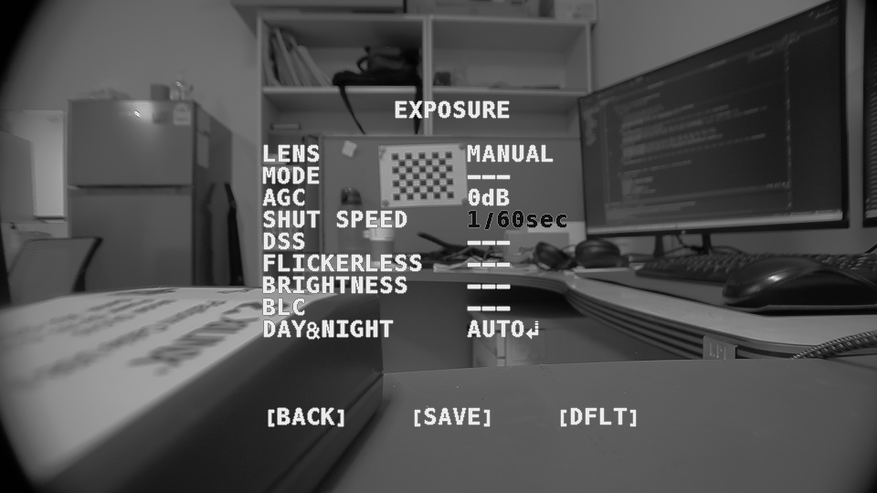
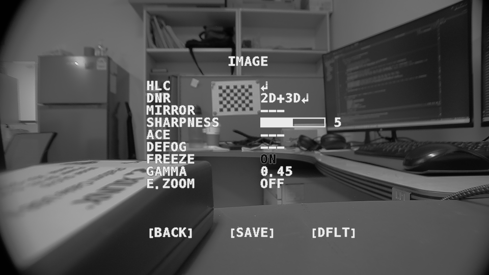

# EO FPS verification evidence

Updated 8 October 2026 (Asia/Seoul). This is the compact GitHub checkpoint of
the bench investigation. The complete narrative and next USB3 test are in
[the test report](../TEST_EO_CAMERA_CONTENT_20261007.md) and
[the work log](../EO_INPUT_FPS_WORKLOG.md).

**Verdict:** approximately 60 input rasters/s is confirmed at 1080p60. The
previous claim of 60 fresh full frames/s is withdrawn because the original
diagnostic also reports that rate with camera Freeze ON. The new build observes
approximately 30 changes/s in its monitored ROI at directly read 1/60 s, but
whole-frame fresh FPS remains unverified.

## Report and measurements

- [Consolidated Excel report](EO_Camera_FPS_Consolidated_Report_20261007.xlsx):
  latest verified contents, retaining its original filename. New verification
  begins at Report row 125 and Exposure Sweep row 233. Direct OSD images are
  embedded at Report rows 163–199.
- [Curated verification results](verification_results.json): eight conditions,
  generated trigger rates, raw counts, interpretation and manual reference.
- Eight `crc*/summary.json` files preserve the original decoder output. The
  original-r2 frozen summary's `content_rate_accepted` value is **not** an
  accepted verdict; the independent Freeze control invalidates it.
- Two `image60_frozen*/snapshot_summary.json` files record identical sampled Y
  images bracketing the original-r2 test. This is a 960x540 decimated Y check,
  not proof of equality of every full-resolution Y/C byte.
- [Snapshot build hashes and timing](snapshot_build_manifest.json),
  [original r2 build hashes and timing](original_r2_build_manifest.json), and
  [verified restoration record](restored_state.json).
- [Workbook validation](workbook_validation.json): four sheets, three embedded
  OSD images, 492 evidence links, preserved historical cells outside the stated
  corrections, and no formula errors.
- [Archive manifest](archive_manifest.json): source locations, sizes and SHA-256
  hashes for every archived file except this index and the manifest itself.

The workbook's evidence hyperlinks point to the original Windows bench paths.
They require the local capture/build archive; they are not portable GitHub
links. Its displayed results and embedded images remain available independently.
Raw CSVs, full capture images, Vivado projects/checkpoints and bitstreams remain
local, consistent with the repository's existing `captures/` exclusion. The
manufacturer PDF is referenced by filename, page and hash, not redistributed.

## Directly reviewed OSD images

30-mode shutter before changing HD FORMAT:

After selecting 1080p60, without an intervening shutter command:

Freeze enabled for the negative control:

## Reproduction and validation

RTL, build/capture procedures and tests are versioned in
[`diagnostics/eo60`](../../diagnostics/eo60/README.md) and
[`diagnostics/eo60_snapshot`](../../diagnostics/eo60_snapshot/README.md).
The report's authoring/consolidation scripts are archived verbatim under
`report_source/`; their paths refer to this bench and the complete local
evidence archive. They are provenance copies, not a standalone report build
from this reduced evidence bundle. Authoring used `@oai/artifact-tool`; the
OpenXML helper supplies native file hyperlinks, and openpyxl is used only for
read-only validation.

Before the Git checkpoint, the input-content decoder regression passed, both
eight-test dedicated decoder suites passed, and the independent snapshot
decoder fixture passed coordinates, byte order, sequence wrap, a one-pixel
change and missing-packet rejection. Earlier RTL simulations and live tests
are documented in the source-package READMEs. No additional hardware test or
programming was performed just to create the Git checkpoint.
